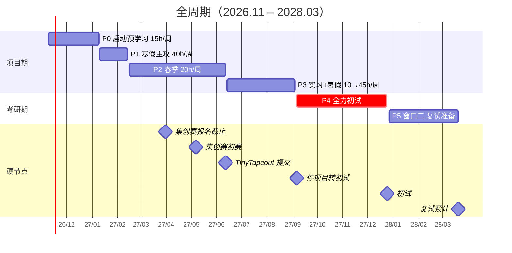

---
tags:
  - 时间表
  - 规划/考研
version: 3
status: current
created: 2026-11-08
updated: 2026-11-08
total_content_hours: 937
total_capacity_hours: 975
buffer_hours: 38
---

# 全周期时间表 v3（2026.11 – 2028.03）

> [!abstract] 一句话
> **2026.11 起步 → 2027.09.06 停项目 → 2027.12.25 初试 → 2028.03 复试。**
> 内容 937h / 容量 975h / 缓冲 38h。严格单人 · 不做板级 · 不碰水赛。

> [!tip] 现在在哪
> 今天 **2026-11-08**，还在 W0 准备期，**W1 = 2026-11-09 开始**。
> 下一个硬节点：**2027-01-09**（寒假开始，进入主攻期）。最近的外部截止：**2027-03-31**（集创赛报名）。

细则（项目清单、复试叙事、AI 分工、来源）见 [[项目规划|项目规划]]；本页只负责「一眼看完」。

## 一、一张图（甘特）



## 二、六阶段总表

| 阶段 | 日期 | 周数 | 周工时 | 容量 | 主线产出 |
| --- | --- | --- | --- | --- | --- |
| P0 启动 | 2026.11.09–2027.01.09 | 9 | 15h → 期末 5h | 105h | 环境、预学习、C++、HDLBits |
| P1 寒假（主攻） | 2027.01.10–02.13 | 5 | 40h（春节周 25h） | 185h | 五级流水 CPU、FIFO/CDC、Cache、简历物料 |
| P2 春季 | 2027.02.15–06.12 | 17 | 20h | 340h | A 阶段、形式验证、仿真器、GEMM、运放、TinyTapeout、OSPP 申请、集创赛 |
| P3 实习+暑假 | 2027.06.13–09.04 | 12 | 10h（实习 4.5 周）/ 45h | 345h | 数字后端、OSPP 结项、上板、收尾 |
| P4 初试 | 2027.09.06–12.24 | 15 | 0（项目全停） | — | 全力初试 |
| P5 窗口二 | 2027.12.27–2028.03.20 | 12 | 5 → 25 → 15h | 210h | 毕设、作品集、复试 |

**关键结构**：GEMM 从暑假前移到 4 月，唯一原因是集创赛初赛 5.7 截止。

## 三、月度视图（这个月在干什么）

| 月 | 阶段 | 主线 | 并行 | 硬截止 |
| --- | --- | --- | --- | --- |
| 2026-11 | P0 | 装环境、注册一生一芯、数字电路复习 | — | — |
| 2026-12 | P0 | Verilog 小模块、ISA 精读、C++ 补强 | 集创赛选题 | — |
| 2027-01 | P0→P1 | 单周期 CPU、五级流水骨架、冒险处理 | 集创赛报名与盖章 | 01.09 寒假开始 |
| 2027-02 | P1 | **五级流水 CPU 完成**、FIFO/CDC、Cache、简历 | — | 02.14 收尾日 / 02.15 开学 |
| 2027-03 | P2 | A 阶段、形式验证 | 集创赛中期准备 | 03.31 集创赛报名截止 |
| 2027-04 | P2 | 形式验证、**GEMM 加速器**、运放 | 集创赛中期、OSPP 申请、实习面试 | 04 月中 集创赛中期 |
| 2027-05 | P2 | 运放版图与后仿、TinyTapeout | 集创赛初赛、实习确认 | 05.07 集创赛初赛截止 |
| 2027-06 | P2→P3 | 期末、TinyTapeout 提交、设计文档 | 实习开始 | 06.12 TinyTapeout 提交 |
| 2027-07 | P3 | 实习（碎片活）、恢复周、**数字后端开工** | OSPP 开发 | — |
| 2027-08 | P3 | 数字后端 + PPA、OSPP 结项、上板 | 收尾物料 | — |
| 2027-09 | P3→P4 | 作品集初稿 → **09.06 停项目** | — | 09.06 硬切换 |
| 2027-10 | P4 | 初试：数学 / 专业课 / 英语 / 政治 | — | — |
| 2027-11 | P4 | 初试 | — | — |
| 2027-12 | P4 | 初试冲刺 | — | 12.25–26 初试 |
| 2028-01 | P5 | 毕设开题、项目收尾 | 考研课与期末 | — |
| 2028-02 | P5 | 作品集、复试材料 | 出分（2 月中下） | 02 月底 作品集定稿 |
| 2028-03 | P5 | 复试准备 | 自划线（3 月上旬） | 03 月下旬 复试 |

## 四、逐周表（W1–W31 + 后续时段）

| 周 | 日期 | 阶段 | 主任务 | 硬节点 |
| --- | --- | --- | --- | --- |
| W1 | 11.09–11.15 | P0 | 装 Verilator / GTKWave / Yosys / Icarus；注册一生一芯，读预学习清单 | — |
| W2 | 11.16–11.22 | P0 | 数字电路复习 + Verilog 语法 | — |
| W3 | 11.23–11.29 | P0 | 3 个 Verilog 小模块（计数器、状态机、UART） | — |
| W4 | 11.30–12.06 | P0 | RV32I ISA 精读 | — |
| W5 | 12.07–12.13 | P0 | C++ 表达式求值器（补 EDA 线的语言底子） | — |
| W6 | 12.14–12.20 | P0 | C++ JSON parser；集创赛选题定稿 | — |
| W7 | 12.21–12.27 | P0 | 预学习收尾；联系 1–2 位指导老师 | — |
| W8 | 12.28–01.03 | P0 | 期末，5h 只维护 | — |
| W9 | 01.04–01.09 | P0 | 期末，5h 只维护 | 01.09 寒假开始 |
| W10 | 01.11–01.17 | P1 | 单周期 RV32I CPU | 01.17 预学习检查点 |
| W11 | 01.18–01.24 | P1 | 单周期测试 + 五级流水骨架 | — |
| W12 | 01.25–01.31 | P1 | 数据冒险 forwarding + 控制冒险；**集创赛报名与学院盖章** | — |
| W13 | 02.01–02.07 | P1 | 春节（25h）：异步 FIFO + CDC、简历初稿 | 02.06 春节 |
| W14 | 02.08–02.14 | P1 | Cache、汇编器、仿真器 parser；README / 演示视频 / 一页简历定稿 | 02.14 收尾日 |
| W15 | 02.15–02.21 | P2 | A 阶段：完整 RV32I + 测试集 | 02.15 开学 |
| W16 | 02.22–02.28 | P2 | A 阶段续 | 02.28 单周期 CPU 检查点 |
| W17 | 03.01–03.07 | P2 | A 阶段收尾、SoC 集成 | — |
| W18 | 03.08–03.14 | P2 | 形式验证（SymbiYosys）起步 | — |
| W19 | 03.15–03.21 | P2 | 形式验证：ALU 等价 + 流水线无死锁 | — |
| W20 | 03.22–03.28 | P2 | 脉动阵列 GEMM 加速器 | — |
| W21 | 03.29–04.04 | P2 | GEMM 收尾 | 03.31 集创赛报名截止 |
| W22 | 04.05–04.11 | P2 | **集创赛中期检查**；OSPP 选项目 | 04 月中 中期检查 |
| W23 | 04.12–04.18 | P2 | 运放原理图与仿真；**OSPP 申请（带原型）** | 04.20 中期检查点 |
| W24 | 04.19–04.25 | P2 | 运放仿真收尾；**实习面试** | 04.30 形式验证检查点 |
| W25 | 04.26–05.02 | P2 | 运放版图；**集创赛初赛提交** | 05.07 初赛截止 |
| W26 | 05.03–05.09 | P2 | 运放 DRC / LVS / 后仿；实习确认 | — |
| W27 | 05.10–05.16 | P2 | 运放后仿收尾 | — |
| W28 | 05.17–05.23 | P2 | TinyTapeout 设计 | — |
| W29 | 05.24–05.30 | P2 | TinyTapeout 仿真与 DRC | — |
| W30 | 05.31–06.06 | P2 | 期末；写完数字后端与 GEMM 的**设计文档** | — |
| W31 | 06.07–06.12 | P2 | 期末；**TinyTapeout 提交** | 06.12 提交截止 |
| — | 06.13–07.15 | P3 | 实习：每周 10h 只做碎片活（OSPP issue/PR、读源码、补 README） | 06.30 到 A 阶段检查点 |
| — | 07.16–07.22 | P3 | 恢复周 20h | — |
| — | 07.23–08.05 | P3 | 数字后端全流程 + PPA 报告（90h） | 07.31 后端检查点 |
| — | 08.06–08.19 | P3 | OSPP 结项 + **装 Vivado** + 上板验证（90h） | — |
| — | 08.20–09.04 | P3 | README、博客、简历、作品集初稿（85h） | — |
| — | 09.06–12.24 | P4 | 全力初试 | 12.25–26 初试 |
| — | 12.27–01.08 | P5 | 课与期末，5h/周 | — |
| — | 2028.01.09–02.13 | P5 | 寒假 25h/周：毕设开题 + 作品集 | 02 月底 作品集定稿 |
| — | 02.15–03.20 | P5 | 复试准备 15h/周 | 03 月下旬 复试 |

## 五、关键日期一览

| 日期 | 事项 | 类型 | 备注 |
| --- | --- | --- | --- |
| 2026-11-09 | W1 开始 | 起点 | 装环境 + 注册一生一芯 |
| 2027-01-09 | 厦大寒假开始 | 外部 | 进入 P1 主攻期 |
| 2027-02-14 | 寒假收尾日 | 自设 | 只修 bug / 写 README，不开新功能 |
| 2027-02-15 | 厦大第二学期开学 | 外部 | 无缓冲周 |
| 2027-03-31 | **集创赛报名截止** | 外部 | 押金 300 元/队 |
| 2027-04 中 | 集创赛中期检查 | 外部 | 4 月最危险的一周 |
| 2027-05-07 | **集创赛初赛作品提交** | 外部 | 未提交即弃赛 |
| 2027-06-12 | **TinyTapeout 提交** | 外部 | $100 起 |
| 2027-06-13 | 小学期 / 实习开始 | 外部 | 12 周里的前 4.5 周 |
| 2027-07 | 集创赛分赛区决赛 | 外部 | 撞实习 |
| 2027-08 下 | 集创赛全国总决赛 | 外部 | 撞 OSPP 结项 |
| 2027-09-06 | **无条件停项目，转初试** | 红线 | 不可协商 |
| 2027-12-25/26 | **考研初试** | 外部 | 2028 届 |
| 2028-02 中下 | 初试出分 | 外部 | — |
| 2028-03 上 | 34 所自划线公布 | 外部 | 华五与厦大同为自划线 |
| 2028-03 下旬 | 复试 | 外部 | 作品集须 2 月底前定稿 |

## 六、检查点与止损线

| 日期 | 检查点 | 不达标怎么办 |
| --- | --- | --- |
| 2027.01.17 | 一生一芯预学习 | 延到 2 月底，砍汇编器 |
| 2027.02.28 | 单周期 CPU 跑通 | 砍 GEMM |
| 2027.04.20 | 集创赛中期 | GEMM 未跑通则改用 CPU / SoC 顶上 |
| 2027.04.30 | 形式验证出结果 | 只保 ALU 证明 |
| 2027.05.07 | 集创赛初赛提交 | 未提交即弃赛，不追 |
| 2027.06.30 | 到 A 阶段 | 放弃上板，只保 RTL + 仿真 + 认证笔试 |
| 2027.07.31 | 后端跑通 | 只交综合报告 |
| **2027.09.06** | — | **无条件停项目，转初试** |

**三个撞车点**：2027.04（集创赛中期 + OSPP 申请 + 实习面试 + 形式验证收尾）／2027.05 上旬（集创赛 5.7 + 期中 + TinyTapeout）／2027.07（实习 + 分赛区）。

## 七、怎么用这张表

1. **每周一**：在本表找到当周，确认这周的「主任务」，再去 [[项目规划|项目规划]] 查细节。
2. **每周日**：只问一句「这周定的事做完了吗」，没做完就照实记下来，不要偷偷顺延。
   **顺手把下周单出了**：桌面助手点 `生成下一周`，或双击 `同步时间表.cmd`（周日跑会自动把下周一起备好）。
3. **每次改计划**：不要直接改这一页。新建 `1-时间表/YYYY-MM-DD 全周期时间表 vN.md`，把本页 `status` 改成 `archived`，再更新 [[1-时间表/00-总览|时间表总览]] 与 [[首页|首页]]。
   （日常任务变化不用改计划——直接在 `周/` 的任务单里增删勾选项，脚本按勾选算进度。）
4. 本页只放视图，**不放叙事**——叙事在 [[项目规划|项目规划]] 的「复试叙事」一节。

## 八、版本记录

| 版本 | 日期 | 主要变化 |
| --- | --- | --- |
| v1 | 2026-11-08 | 初版，未考虑厦大校历 |
| v2 | 2026-11-08 | 按厦大 2026-2027 校历重排，纳入小学期实习 |
| v3 | 2026-11-08 | 加入集创赛（60h），Bandgap/LDO 挤出；内容 937h / 容量 975h / 缓冲 38h |

<!-- AUTO:PROGRESS:START -->
## 九、实际进度（自动生成，勿手改）

> 由 `1-时间表/_tools/timeline.py` 于 2026-11-08 03:16 生成。手改会在下次运行被覆盖。

| 阶段 | 覆盖周 | 任务 | 已完成 | 完成率 |
| --- | --- | --- | --- | --- |
| P0 启动 | W1–W2 | 11 | 0 | 0% |
| **合计** | — | **11** | **0** | **0%** |

今天不在 W1–W31 范围内。

<!-- AUTO:PROGRESS:END -->

## 十、实时勾选看板（Dataview，打勾后刷新即变）

> 上面第九节是脚本生成的**静态快照**（给不看 Obsidian 的场合用，比如导出/打印）；
> 这一节是 Dataview **实时读**周单里的勾选框，不用跑任何命令。

**每周完成情况**

```dataview
TABLE WITHOUT ID
  file.link AS 周单,
  length(file.tasks) AS 总数,
  length(filter(file.tasks, (t) => t.completed)) AS 已完成,
  length(filter(file.tasks, (t) => !t.completed)) AS 剩余
FROM "1-时间表/周"
SORT file.name ASC
```

**还没勾掉的任务**

```dataview
TASK
FROM "1-时间表/周"
WHERE !completed
```

## 十一、前置补课挂点（不动工时）

> 来自 [[前置知识与知识地图]] 第 7 节。**只挂周次，不改下面的逐周表**——那张表是 `timeline.py` 要解析的，列结构一改脚本就断。

| 周次 | 补什么 | 时长 |
| --- | --- | --- |
| W2–W3 | 数电里的 CMOS 门电路（Weste 1–2 章 / Rabaey 5 章） | 10h |
| W10–W11 | 计算机组成：流水线 + 存储层次（CSAPP 4 章） | 15h |
| W13–W14 | 编译原理最小集：词法 + 递归下降 | 8h |
| W20 前后 | 线代在 EDA 里的用法（稀疏矩阵、解线性方程组） | 8h |
| 2027.1 寒假 | 模拟前置：小信号 + 波特图（Razavi 2–3 章） | 20h |
| 2028.1–2 | 器件 + 工艺（**复试向**，不是项目向） | 不计入 |

**三个"排了就翻车"的缺口**：①编译原理原排在 P2，但仿真器 parser 在 W14 就要写 ②C++ 只"学过语法"会让仿真器 70h 变 140h ③模拟的小信号 / 波特图不能边做边学。详见 [[前置知识与知识地图]] 第 6 节。

## 相关链接

- 上一级：[[1-时间表/00-总览|时间表总览]] · [[首页|首页]]
- 本周任务单：`1-时间表/周/`（勾选框只在那里）· 出单与算进度：双击 `1-时间表/_tools/同步时间表.cmd`
- 细则：[[项目规划|项目规划]] · [[考研/主页|考研主页]] · [[考研/里程碑与倒计时|里程碑与倒计时]]
- 配套：[[90-项目实战/微项目练习清单|微项目练习清单]] · [[微电子学习资源与刷题工具|学习资源与刷题工具]] · [[集创赛/00-总览|集创赛总览]]
