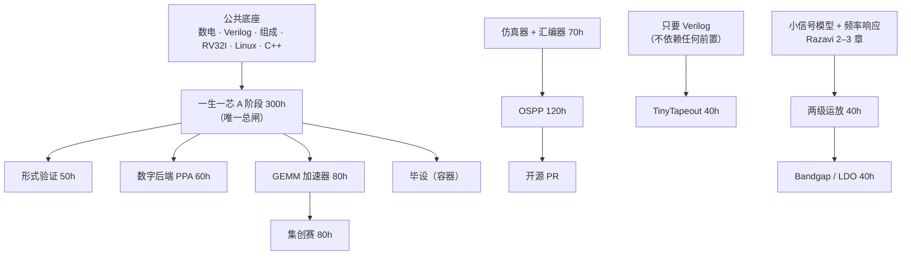

---
tags:
  - 规划/知识地图
  - 时间表
created: 2026-11-08
updated: 2026-11-08
---

# 前置知识与知识地图

> [!abstract] 一句话
> **前置** = 开工**之前**必须会，不会就卡死（补起来按周算）。
> **必要所学** = 做的**过程中**补，边做边学（补起来按天算）。
> **学科基础** = 复试一定会问，但项目不一定用得上（按"复试科目"排，不按"项目需要"排）。
>
> 三者混在一起排，是这类计划最常翻车的地方。

## 0. 这篇怎么用

- **开工前只查「前置」那一栏**。别提前学「边做边学」的东西——学了也会忘，等用到再学。
- **每周一**在 [[2026-2028 全周期时间表]] 找到当周，回来查对应项目的「最大的坑」，提前避。
- **复试前两个月**只看第 9 节「复试高频十题」和第 5 节的「堆三」，前面的都不用再翻。

---

## 1. 项目线的三层依赖



**四条链，只有一个总闸。**

| 链 | 上游 | 下游 | 说明 |
| --- | --- | --- | --- |
| 数字主干 | 公共底座 | 一生一芯 A → 形式验证 / 数字后端 / GEMM / 毕设 | A 阶段是**唯一总闸**，它不动，后面三样都不能开工 |
| EDA 线 | 编译原理最小集 + C++ | 仿真器 + 汇编器 → OSPP → 开源 PR | 与数字主干**并行**，但共用 C++ 功底 |
| 流片线 | 只要 Verilog | TinyTapeout | **不依赖任何前置**，1–2 周就能做完，随时可插 |
| 模拟线 | 小信号 + 波特图 | 运放 → Bandgap / LDO | 上游**不能边做边学**，必须提前 |

> [!tip] 一个反直觉的结论
> TinyTapeout 是 4 项 S 级里**前置要求最低**的（只要会写 Verilog），却是唯一能给你「流片记录」的。
> 如果哪天状态很差、写不动 CPU，去做 TinyTapeout 是最回本的选择。

---

## 2. 公共底座（六样，W1–W6，约 60h）

这六样是**所有后面东西的地基**，W1–W6 就要开始攒。

| 知识 | 到什么程度算够 | 自检方式 |
| --- | --- | --- |
| 数字逻辑 | 组合/时序、触发器、状态机、竞争冒险 | 能手画一个三段式状态机并说明为什么用三段 |
| Verilog 可综合子集 | 会写 always @(posedge)、阻塞/非阻塞区别、能综合 vs 不能综合 | 能判断一段代码综合出来是什么电路 |
| 计算机组成 | 指令周期、数据通路、流水线概念 | 能手算一条 `lw` 的五级流水各周期在干什么 |
| RISC-V RV32I | 六种指令格式、常用指令编码 | 能手写 `beq x1, x2, 8` 的机器码 |
| Linux / Git / Make | 命令行、分支、commit/PR | 能不查资料建仓库并提一个 PR |
| C / C++ | **能写 2000 行**，不是"学过语法" | 不看书写一个 600 行表达式求值器 |

> [!warning] C++ 是这条线最大的隐性风险
> 仿真器 70h 的前提是 C++ 够用。如果只是"学过语法"，这 70h 会变成 140h，整条 EDA 线会塌。
> **W5–W6 结束必须做一次自检**：能不能不看书写出 600 行的表达式求值器（词法 + 递归下降 + 求值）。写不出来就先把 C++ 补到能写。

---

## 3. 13 项逐项：前置 / 边做边学 / 工具 / 最大的坑

| 项目 | 前置（硬，开工前） | 边做边学 | 工具 | 最大的坑 |
| --- | --- | --- | --- | --- |
| 一生一芯 A 阶段 300h | 数电、Verilog 可综合子集、RV32I 六种格式、Linux | 流水线冒险、SoC 总线、上板约束 | Verilator / iverilog、GTKWave、Yosys、Vivado（2027.8 才装） | 把 A 阶段当"照抄讲义"；不做测试就上板 |
| 形式验证 50h | SVA 断言语法、状态机思维、布尔逻辑 | SymbiYosys 的 `sby` 配置、k-induction、cover | Yosys + SymbiYosys（`smtbmc`） | 一上来证"整个 CPU"证不动；应先证 ALU 等价 + 流水线无死锁 |
| 仿真器 + 汇编器 70h | **编译原理最小集（词法 + 递归下降）**、C++ 2000 行、数据结构 | 事件驱动 vs 周期驱动调度、VCD 格式 | C++17、CMake、Python | 一上来支持完整 Verilog；应先固定"我的 CPU 用到的那 20 个语法" |
| GEMM 加速器 80h | 脉动阵列数据流、定点/浮点表示、AXI 握手 | 分块（tiling）、双缓冲、DMA | Verilator、numpy（对拍） | 只做 4×4 玩具；要有实测吞吐 vs CPU 的对比数据 |
| 数字后端 PPA 60h | 综合 → 布局 → 布线 → STA 的流程概念、setup/hold、时钟树 | OpenLane 配置、Sky130 库、DRC/LVS | OpenLane / OpenROAD、KLayout、Magic | 跑通就完事，不做"换约束看 PPA 变化"的对比实验 |
| TinyTapeout 40h | **只要 Verilog + 会写 testbench** | 1 tile 的资源约束、引脚映射、Wokwi | GitHub Actions（自动跑 GDS）、info.yaml | 设计超出 1000 门；不先在本地免费跑通 GDS action |
| OSPP 120h | C++ 或 Python 之一熟练、Git PR 流程、能读英文源码 | 目标项目的架构、issue 讨论礼仪 | git、gdb、valgrind、CMake | 等申请期才开始；应先提 2–3 个 PR |
| 两级运放 40h | **小信号模型、频率响应 / 波特图、反馈稳定性** | 版图匹配、寄生提取、后仿 | ngspice / Xschem、Magic、KLayout | 只做前仿；不做版图 + DRC/LVS + 后仿，等于没做 |
| Bandgap / LDO 40h | 运放的基础 + 温度系数、PSRR 概念 | 启动电路、环路补偿 | 同上 | 仿真不收敛就放弃；应先做 DC 工作点 |
| 异步 FIFO + CDC 15h | 同步 FIFO、亚稳态概念、格雷码 | 两级同步器、多 bit 为什么不能只打两拍 | Verilator + SymbiYosys | 只做仿真不做形式验证（CDC 的 bug 仿真抓不到） |
| 直接映射 Cache 15h | 存储层次、地址划分 | 写回 / 写直达、替换策略 | Verilator | 不做命中率曲线（换容量跑一组数据） |
| 集创赛 80h | 上面任一项目的实际能力 + 选题调研能力 | 赛题文档、答辩 | — | 选到"基于 XX 开发板的系统应用"类赛题（板级，你不做） |
| 毕设（容器） | 同上 | 论文写作 | LaTeX / Word | 选题与主线脱节 |

---

## 4. 五层学科知识（L0–L4）

```text
L4 工程素养    Linux · Git · Make/CMake · Python · 英文文献 · 画图/LaTeX
        ↑
L3 计算机      数据结构 · 操作系统 · 编译原理 · 计算机组成 · 体系结构
        ↑
L2 专业核心    半导体物理 · 半导体器件 · 模拟IC设计 · 数字IC设计 · 微电子工艺
        ↑
L1 电路        电路分析 · 模拟电子技术 · 数字电子技术 · 信号与系统
        ↑
L0 数学        高等数学 · 线性代数 · 概率统计 · 复变与积分变换 · 数值分析
```

**一句话判断**：L0–L1 是"学过就该会"的，L2 是"决定你是不是微电子的人"的，L3 是"数字方向的分水岭"，L4 是"能不能干活"的。

### L0 数学

| 知识块 | 项目里用在哪 | 复试/考研 |
| --- | --- | --- |
| 高等数学 | 小信号线性化（一阶泰勒）、RC 一阶响应 | 数一必考 |
| **线性代数** | **EDA 的地基**：电路仿真解 `Gx=b`、STA 稀疏求解、GEMM 分块、PCA | 数一必考 |
| 概率统计 | 工艺波动建模、统计时序分析（SSTA）、良率 | 数一考 |
| **复变与积分变换** | 波特图就是 `s=jω`；运放稳定性、滤波器 | 信号与系统前置 |
| 数值分析 | 牛顿迭代、稀疏线性求解、龙格库塔 | 一般不讲，EDA 方向要自己补 |

### L1 电路（硬地基，糊了后面全歪）

| 知识块 | 用在哪 |
| --- | --- |
| 电路分析 | KCL/KVL、节点法、戴维南、一二阶动态电路、正弦稳态、谐振、二端口 → 一切模拟的基础；版图寄生 RC 网络 |
| 模拟电子技术 | 二极管、BJT/MOS 放大、差分放大、反馈、运放、频率响应、振荡 → 运放 / Bandgap / LDO |
| 数字电子技术 | 逻辑门、组合/时序、触发器、竞争冒险、**CMOS 门电路** → 所有数字项目 |
| 信号与系统 | 卷积、傅里叶、拉普拉斯、Z 变换、稳定性判据 → 频率响应、稳定性 |

> [!warning] 很多学校的数电只讲到 74 系列和卡诺图
> **不讲 CMOS 门内部结构**。而数字 IC 设计恰恰从 CMOS 门开始。这一段要么补 Weste / Rabaey 的第 1–2 章，要么后面看综合报告时永远不知道工具在干什么。

### L2 专业核心（决定"你是不是微电子的人"）

| 知识块 | 项目里用在哪 | 复试会不会问 |
| --- | --- | --- |
| **半导体物理** | 器件建模、工艺理解 | **必问** |
| **半导体器件** | 模拟设计要用；数字方向也要懂 | **必问** |
| 模拟 IC 设计 | 运放 + Bandgap / LDO | 模拟方向必问 |
| 数字 IC 设计 | 数字项目 + 后端 PPA | 数字方向必问 |
| VLSI / 设计方法学 | 数字后端 | 会问 |
| 微电子工艺 | 理解 Sky130、TinyTapeout 的物理背景 | **常问** |

> [!important] 最重要的一句
> 你可以只做数字，但**不能不懂器件**。
> 华五微电子的面试老师大概率是器件 / 工艺 / 模拟出身，问数字的人反而少。
> 数字做得再好，被问"MOS 的 C-V 曲线为什么有三个区"答不上来，印象分立刻掉。

### L3 计算机（数字方向的分水岭）

| 知识块 | 用在哪 | 缺了会怎样 |
| --- | --- | --- |
| 数据结构与算法 | 仿真器、OSPP、EDA | 写不出像样的 C++ |
| 操作系统 | Linux 使用、多线程仿真 | 只会在 Linux 里敲命令 |
| **编译原理** | 仿真器 parser、汇编器、Yosys 的 RTLIL | **EDA 线直接断** |
| 计算机组成 | 一生一芯 | 写不出 CPU |
| 计算机体系结构 | 一生一芯 A 阶段、GEMM | 项目停在"能跑"，讲不出为什么快 |

> [!note] 微电子本科最常见的两个缺口
> **「数字集成电路设计」**和**「编译原理」**——前者很多学校不开，后者基本不开。
> 这两个恰好是这条路线（数字 + EDA）的两根柱子。

### L4 工程素养

Linux / Shell、Git（分支 / rebase / PR）、Make / CMake、Python 脚本、英文文献阅读（IEEE 论文、工具手册）、画图（波形图 / 版图 / 框图）、LaTeX。

不难，但**缺了会拖慢一切**：不会读英文手册，Verilator 的文档就看不动；不会 Git 分支，OSPP 的 PR 流程就走不通。

---

## 5. 三堆：按"什么时候会卡住你"排

别按学科重要程度排，按**什么时候会卡住你**排。

### 堆一：现在就该有（大二大三学过，糊了就补）

| 知识 | 补的判断标准 |
| --- | --- |
| 数字电子技术 | 能画出 CMOS 反相器并说出每条支路的电流 |
| 模拟电子技术 | 能画出差分对，说出共模抑制比由什么决定 |
| 电路分析 | 能对含受控源的电路列节点方程 |
| 半导体物理 | 能画 PN 结能带图，解释内建电势 |
| 信号与系统 | 能画一阶系统的波特图，说出 -3dB 点在哪 |
| 高等数学 / 线性代数 | 考研要考，且线代是 EDA 的地基 |

**这六样既是复试必问区，也是考研专业课的内容。** 所以别把它们当"补基础"——它们就是初试复习，**一件事两用**。

### 堆二：项目要用、边做边补

| 知识 | 什么时候必须到位 |
| --- | --- |
| 编译原理（词法 / 语法分析） | 2027.2 仿真器 parser 开工前（6h 够用） |
| 计算机体系结构（Cache / 流水线细节） | W10–W11 单周期 → 五级流水 |
| 数字 IC 设计（CMOS 门 / 时序 / 功耗） | W15 A 阶段 + 后端时 |
| VLSI 流程（综合 / STA / PR） | 2027.7 后端 60h |
| 模拟 IC 设计（Razavi 第 2–3 章） | 2027.1 寒假 20h 预习（运放 4 月开工） |

### 堆三：复试前补，项目里用不上

| 知识 | 为什么还是要学 | 什么时候 |
| --- | --- | --- |
| 半导体器件（短沟道、FinFET、GAA） | 复试必问，也是"你懂不懂这行"的标志 | 2028.1–2（窗口二） |
| 微电子工艺（光刻 / 刻蚀 / 薄膜全流程） | 复试常问；也让你讲 TinyTapeout 时能说到工艺 | 2028.1–2 |
| 器件噪声、可靠性（NBTI / HCI） | 加分项 | 有余力再说 |

---

## 6. 三个时间表缺口（做过才知道）

这三条是排完时间表之后**回头检查才发现的**，都属于"排了就一定翻车"的类型。

| # | 缺口 | 后果 | 补法 |
| --- | --- | --- | --- |
| 1 | 编译原理排在 P2（2027.3），但**仿真器 parser 在 W14（2027.2 上旬）就要写** | 到 2027.2 才发现不会写词法分析，EDA 线整体推迟 3–4 周 | 抽 6h 提前补「词法 + 递归下降」，别的都不用学 |
| 2 | C++ 若只"学过语法"，仿真器 70h 会变成 140h | EDA 线塌方，OSPP 也没了 | W5–W6 自检 600 行表达式求值器；不行就先把 C++ 补到够 |
| 3 | 模拟的小信号模型 / 频率响应**不能边做边学** | 运放做到一半卡在"相位裕度是什么" | 2027.1 寒假 20h 过 Razavi 第 2–3 章 + 波特图 |

---

## 7. 六周补课表（已挂到周次，不动工时）

前四项共约 41h，**全部塞进现有周次**，不新增项目、不加工时。

| 周次 | 补什么 | 时长 | 材料 | 验收 |
| --- | --- | --- | --- | --- |
| W2–W3 | 数电里的 **CMOS 门电路**（反相器 / 传输门 / 功耗） | 10h | Weste《CMOS VLSI Design》第 1–2 章，或 Rabaey 第 5 章 | 能画反相器并说出每条支路电流 |
| W10–W11 | **计算机组成**：流水线 + 存储层次 | 15h | CSAPP 第 4 章 / Patterson《COD》第 4 章 | 能手算 `lw` 的五级周期 |
| W13–W14 | **编译原理最小集**：词法 + 递归下降 | 8h | 《现代编译原理》第 1–2 章，或 Crafting Interpreters 第 4–6 章 | 手写一个能解析 `a=b+c*d` 的 parser |
| W20 前后 | **线代在 EDA 里的用法**（稀疏矩阵、解线性方程组） | 8h | 任何数值线代讲义 | 能说清 STA 为什么解稀疏系统 |
| 2027.1 寒假 | **模拟前置**：小信号 + 波特图 | 20h | Razavi《模拟 CMOS 集成电路设计》第 2–3 章 | 能手画共源放大器的波特图 |
| 2028.1–2 | 器件 + 工艺（**复试向，不是项目向**） | 不计入 | 本科器件 / 工艺教材 | 能答下面十题里的 1–4、10 |

---

## 8. 自检：五个问题

从上往下问，**第一个答不上来的，就是你现在该补的地方**。

1. 能写一个 4 位加法器 + testbench，并在 GTKWave 里看到波形吗？
2. 能把 RV32I 六种指令格式说清，并手工写出 `beq` 的机器码吗？
3. 能手算一条 `lw` 在五级流水里每个周期在干什么吗？
4. 能不看书写出 600 行的 C++ 表达式求值器吗？
5. 知道 setup 违例和 hold 违例分别往哪个方向修吗？

---

## 9. 复试高频十题（华五微电子）

面试里专业课只占 3–5 分钟，但答不上来很致命。**能答上 7 道以上，专业课面试就稳了。**

| # | 问题 | 考的是 |
| --- | --- | --- |
| 1 | 画 MOS 的 C-V 曲线，解释积累区 / 耗尽区 / 反型区为什么这么变 | 半导体物理 |
| 2 | 阈值电压由哪些因素决定？怎么调？ | 半导体物理 / 器件 |
| 3 | 短沟道效应有哪几种？分别怎么抑制？ | 半导体器件 |
| 4 | 为什么先进工艺要用 FinFET / GAA？ | 半导体器件 |
| 5 | 画 CMOS 反相器，说明它的功耗来源有哪几部分 | 数字 IC |
| 6 | setup 违例和 hold 违例分别怎么修？（注意：两者修法方向相反） | 数字 IC / 后端 |
| 7 | 什么是亚稳态？为什么两级同步器能解决？多 bit 信号为什么不能只打两拍？ | 数字 IC / CDC |
| 8 | 画一个两级运放，Miller 补偿补偿的是什么？ | 模拟 IC |
| 9 | 反馈有哪四种组态？稳定性判据是什么？ | 模拟 IC |
| 10 | 光刻的完整工艺流程是什么？分辨率由什么决定？ | 微电子工艺 |

> [!tip] 这十道题横跨 L1–L2
> 正好说明为什么 L2 不能跳。做数字项目时，第 1–2、10 题一个字都用不上，但面试一定问。

---

## 10. 和计划的三条关系

1. **项目清单对 L2 的要求比想象的低，但复试对 L2 的要求比想象的高。**
   做数字项目，半导体物理 / 器件基本用不到；但复试一定问。所以 L2 的器件和工艺按"复试科目"排，放 2028 年 1–2 月。

2. **数学和电路这两层，别单独"补"，合并进考研复习。**
   高数、线代、概率是三门考研课；模电 / 数电 / 信号与系统大概率是专业课。补基础和初试复习是同一件事。

3. **真正稀缺的是「数字 IC 设计」和「编译原理」。**
   前者很多学校不开，后者基本不开，而它们恰好是这条路线（数字 + EDA）的两根柱子。值得单独排时间，别指望"做项目时自然就会"。

---

## 相关链接

- 时间表：[[2026-2028 全周期时间表|全周期时间表]] · [[1-时间表/00-总览|时间表总览]]
- 细则：[[项目规划|项目规划]]
- 练习项目：[[项目实战/微项目练习清单|微项目练习清单]]
- 资源与工具：[[微电子学习资源与刷题工具|学习资源与刷题工具]]
- 考研：[[考研/主页|考研主页]] · [[考研/里程碑与倒计时|里程碑与倒计时]]
